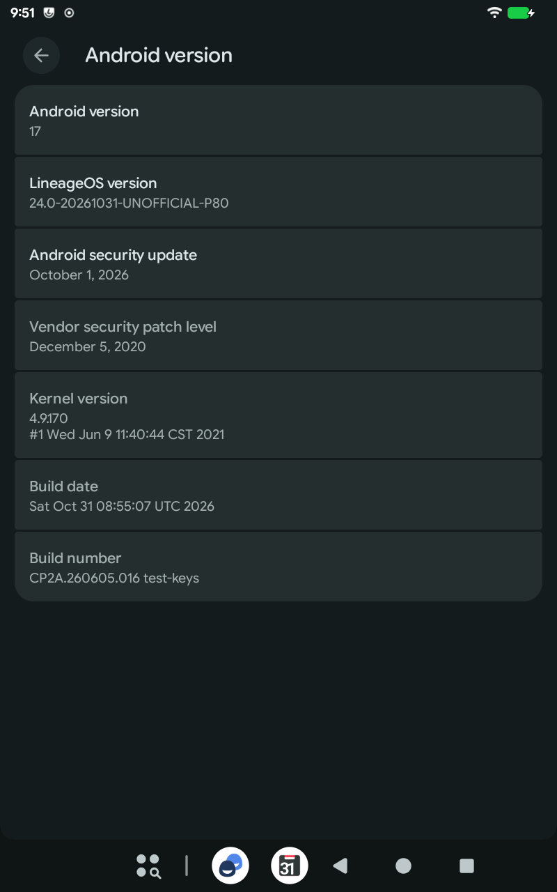

# LineageOS 24.0 for the Teclast P80 (G3M2) — unofficial proof of concept

Unofficial builds of **LineageOS 24.0 (Android 17)** for the **Teclast P80** tablet, variant **G3M2** (Allwinner A133, 2 GB RAM, 8″ 800×1280).
This project is not affiliated with LineageOS or Teclast.

**This is a proof of concept.** Android 17 is made for Linux 5.10 or newer; the P80 runs Teclast's Linux 4.9 from 2021, and Teclast does not publish its source.
The build runs anyway, thanks to compatibility patches for old kernels, and it passed the tests below on one tablet, but parts of Android 17 run in a reduced mode on this kernel (see [Known limitations](#known-limitations)).
The earlier **[LineageOS 23.2 (Android 16) build](https://github.com/6Xkljk8Vj7Tk1k4/lineageos-p80-builder)** for the same tablet keeps more of Android's network stack on this kernel (its eBPF programs load) and runs 32-bit apps, but it is **no longer maintained**: there will be no new 23.2 builds, and it lacks the fixes made for this one (for example, sound stays off until a restart if Teclast's audio service crashes, the tracing service crash-loops after every boot, and there is no deep Doze).

Teclast never updated the P80 beyond Android 10 with the December 2020 security patch, and without the kernel source a regular LineageOS device port is not possible.
The tablet supports Project Treble, though: this build replaces only the Android system and keeps Teclast's kernel and vendor partition (the drivers).
It is LineageOS with the [TrebleDroid](https://github.com/TrebleDroid) compatibility layer.
TrebleDroid and [MisterZtr's LineageOS_gsi](https://github.com/MisterZtr/LineageOS_gsi), whose recipe the 23.2 build follows, had no Android 17 version yet, so the Android 17 versions of TrebleDroid's patches and the patches for old vendor kernels come from [RestlessOS](https://github.com/cawilliamson/treble_restlessos) by cawilliamson, rebased onto LineageOS where needed.
The fixes this tablet needs are patch files in this repository (`patches/lineage-24.0/`), applied at build time.
Everything runs in a Podman container, so the host only needs Podman and disk space.

How it came about: after LineageOS 23.2 ran well on my P80, I wanted to know whether Android 17 could run on its 2021 kernel at all.
As with 23.2, [Claude](https://claude.ai) (Anthropic's AI assistant, used through Claude Code) did most of the porting work — combining the patch sets, finding out why each test boot failed, writing the fixes and this documentation — while I tested on the tablet.

## Which tablet

Only the **P80 G3M2**, sold from late 2020 with Android 10.
The product ID is printed on the label on the back or on the box, and `adb shell getprop ro.product.device` shows it too (`P80_G3M2_EEA` on the tablet this was tested on).

Teclast used the name P80 for several different tablets. **Do not flash this on any other variant**: the P80 G3M3 (A133 as well, but another manufacturer's board with other display panels, touch and cameras; Android 11 firmware), the P80X (Unisoc SC9863A), the P80T (A133, 3 GB, Android 12) or the older P80 3G / P80h (MediaTek).
The G3M6 product ID may be the same hardware as the G3M2 but has not been tested.

## Status



Tested on one P80 G3M2 (EEA) with Teclast's latest firmware, V1.04 (2021-06-09), in October 2026: first in seven test boots through DSU (see [Trying it without installing](#trying-it-without-installing-dsu)), which found the problems the patches here fix, then installed.

| Feature | Status |
| --- | --- |
| Boot, display, touch, setup wizard | Works (about 110 s from a restart to the lock screen; the first boot after the installation takes a few minutes) |
| Wi-Fi | Works (tested on 5 GHz; the chip is dual-band; WPA3-only networks are not shown, see below) |
| Bluetooth | Works: turns on and off reliably (the fix against crashes during sleep is the same as on 23.2, where it was verified) |
| Audio | Works (speaker) |
| Cameras | Work: photos with both, video in 720p (rear) and VGA (front) with sound |
| Graphics | Hardware rendering and composition (PowerVR GE8300) |
| Video playback | Hardware decoding through Teclast's codecs (720p H.264 tested in the gallery and the browser) |
| Brightness | Works (Android 17 dropped support for the kind of brightness driver the tablet has; a small bridge service in this build fills the gap) |
| Sensors | Accelerometer and auto-rotate (the tablet has no other sensors) |
| USB file transfer (MTP) | Works |
| Charging while running, battery, deep sleep | Work. Standby with the screen off and Wi-Fi and Bluetooth on: about 1.3 % per hour, the same as 23.2 |
| Apps | The preinstalled apps and the Settings pages open; a current Chromium-based browser runs with hardware acceleration |
| SELinux | Enforcing |
| Not tested yet | microSD card, magnetic cover (hall sensor), wired headphones, Bluetooth audio, charging while switched off, battery life in daily use, long-term stability, updating from 23.2 without erasing the data |

Memory savings were added after those tests: Bluetooth off by default, no equalizer app, no phone, SIM and secure element services, 64-bit apps only and a swap setting for the tablet's compressed RAM (see below).
A build with them went through the same tests on the tablet: about 130 MB less memory in use after boot, and starting eight apps took 11.5 s instead of 12.1 s (switching back to them took 3.0 s, as before), with no crash in the test session.

### Known limitations

- **It is a proof of concept**: Android 17 on a kernel this old is not what Android 17 was made for. Features nobody tested may fail, and a later LineageOS 24.0 update may need new patches before it builds or boots.
- **Reduced network features**: Android 17's network stack relies on eBPF programs written for kernels 5.10 and newer. On this kernel it runs in a reduced mode (from RestlessOS): Wi-Fi and internet work, but features built on those programs, such as per-app data usage statistics, per-app network restrictions and the "block connections without VPN" setting, are expected not to work (not tested).
- **The kernel and the vendor partition stay Teclast's**: Linux 4.9.170 from June 2021 and the vendor security patch level of December 2020.
  The Android security update shown in Settings covers the LineageOS system only; bugs in the kernel and in Teclast's drivers are not fixed.
- **64-bit apps only**: to save memory (about 75 MB), the build does not start Android's 32-bit app runtime. Apps that only contain 32-bit native code cannot be installed.
- **Bluetooth is off by default** (it uses about 28 MB of memory while on). Turn it on in quick settings when you need it.
- **No equalizer, no phone or SIM services**: LineageOS's AudioFX app, Android's phone and SIM services (TeleService, ONS) and its secure element service (SecureElement) are left out to save memory; the tablet has no SIM card slot, NFC or eSIM.
- **No Night Light, extra dim or display color modes**: Teclast's display hardware cannot apply color filters, and with them Android would draw every frame on the graphics chip, which makes the tablet sluggish.
- **No Wi-Fi hotspot or tethering**: the hotspot and USB/Bluetooth tethering are switched off in this build.
- **No desktop windowing**: LineageOS 24.0's desktop mode is turned off; with the tablet's low-memory setting it made the system interface crash at boot.
- **No over-the-air updates**: the Updater app finds nothing for this build. To update, build a new image and flash `system` (see [Installation](#installation)).
- **WPA3-only Wi-Fi networks are not shown**: the Wi-Fi chip's driver (Unisoc UWE5622) has no WPA3 support. Use WPA2, or the router's WPA2/WPA3 transition mode.
- **Adaptive brightness cannot work**: the tablet has no light sensor.
- **The tablet does not sleep while it is connected to a computer** (USB with data): Teclast's USB driver keeps it awake. Whether it sleeps on a wall charger has not been tested.
- **Set the time zone yourself**: without a mobile network or Google's location services Android cannot detect it, and after the setup wizard it was GMT in the tests.
  Pick yours in Settings → System → Date & time (turn off **Set time zone automatically** first).

## Download

There are no regular releases, and this repository is first of all the build recipe.
If a proof-of-concept image is attached under [Releases](https://github.com/6Xkljk8Vj7Tk1k4/lineageos-24.0-teclastp80-builder/releases), it comes as `lineage-24.0-YYYYMMDD-UNOFFICIAL-P80.img.xz` with `empty-product.img` and `SHA256SUMS`; otherwise build it yourself as described under [Building](#building).
Unpack the image before flashing (`xz -d`, or 7-Zip on Windows); it is about 2.4 GB.
On Linux `sha256sum -c --ignore-missing SHA256SUMS` checks the downloads and the unpacked image.

Builds from this repository are signed with the public AOSP test keys, like most unofficial builds: anyone can sign an app or an update with those keys and the tablet trusts it, and an app signed with the public platform key even gets system privileges.
Signing with your own keys is not built into this repository yet.

## Requirements

- A P80 **G3M2** with Teclast's Android 10 firmware.
- **The official firmware** for your tablet, from [Teclast's firmware page](https://www.teclast.com/en/firmware/fchk.php?c=G3M2): it provides `vbmeta.img` for the installation and is the way back to stock.
  The one tested here is `P80(G3M2)_Android 10.0_EEA_V1.04_SZ.rar` (SHA-256 `72919fc0c7598ad93994d19f65849fa7747961f19d8997c377d56fe3bf30bbf3`).
- `fastboot` and `adb` from a recent [SDK Platform-Tools](https://developer.android.com/tools/releases/platform-tools) (fastbootd support is needed; tested with 37.0.1).
- On Linux, a udev rule for Teclast's USB vendor ID; the usual `android-udev-rules` only cover part of it. As root, create `/etc/udev/rules.d/51-teclast-p80.rules`:
  ```
  SUBSYSTEM=="usb", ATTR{idVendor}=="1f3a", MODE="0660", GROUP="plugdev", TAG+="uaccess"
  SUBSYSTEM=="usb", ATTR{idVendor}=="18d1", MODE="0660", GROUP="plugdev", TAG+="uaccess"
  ```
  then run `sudo udevadm control --reload` and reconnect the tablet.
- The battery charged above 50 %.

## Installation

Installing **erases all data** on the tablet.

1. **Get `vbmeta.img`** from the official firmware.
   Unpack the RAR (with `unrar x` or 7-Zip); it contains `Firmware/Firmware.img`.
   Extract its parts with the tool from this repository and keep `vbmeta.fex`:
   ```bash
   python3 tools/imagewty_extract.py Firmware/Firmware.img firmware-parts
   cp firmware-parts/vbmeta.fex vbmeta.img
   ```
2. **Unlock the bootloader** (once; skip this on a tablet that already runs LineageOS 23.2).
   On the tablet: Settings → About tablet → tap **Build number** seven times, then Settings → System → Developer options → turn on **OEM unlocking** and **USB debugging**, connect the tablet and allow the computer.
   Then:
   ```bash
   adb reboot bootloader
   fastboot oem unlock
   ```
   It answers `OKAY` without asking anything on the tablet and erases the data.
3. **Flash** from fastbootd, the bootloader's userspace mode:
   ```bash
   fastboot reboot fastboot        # may report a timeout; the tablet restarts anyway, wait for it
   fastboot --disable-verity --disable-verification flash vbmeta vbmeta.img
   fastboot flash product empty-product.img
   fastboot flash system lineage-24.0-YYYYMMDD-UNOFFICIAL-P80.img
   fastboot erase UDISK
   fastboot reboot
   ```
   From a running LineageOS 23.2, `adb reboot fastboot` goes to fastbootd directly, and `vbmeta` and `product` are already in place: flashing `system` and erasing `UDISK` is enough.
   Erasing `UDISK` (the data partition) is needed when coming from any other system, 23.2 included: keeping the data across the upgrade to Android 17 has not been tested, and going back to 23.2 later needs another erase.

   `empty-product.img` replaces Teclast's `product` partition, which this system does not use and whose space it needs.
   Instead of downloading it you can create it (e2fsprogs 1.47 or newer; on older versions leave out `,^orphan_file`):
   ```bash
   truncate -s 4M empty-product.img
   mkfs.ext4 -q -F -b 4096 -O ^has_journal,^metadata_csum,^64bit,^orphan_file,^metadata_csum_seed -L product empty-product.img
   ```
   `fastboot -w` does not work on this tablet (its data partition is called `UDISK`).
   Do not use `fastboot reboot recovery`: on a similar Allwinner device it left the device in a recovery menu without USB.
4. The first boot formats the data partition and restarts once by itself. The setup wizard appears after a few minutes.

To update to a newer 24.0 build later, keep the data: `adb reboot fastboot`, then only `fastboot flash system <new image>` and `fastboot reboot`.
A build signed with other keys also needs `fastboot erase UDISK`.

### Trying it without installing (DSU)

On a tablet that already runs LineageOS 23.2 (tested) or 24.0 (not tested yet), `tools/p80-dsu.sh` boots a system image once through Android's Dynamic System Updates: the image and a fresh 4 GB data area live in the data partition, the installed system and its data stay untouched, and the next restart returns to the installed system.
It needs adb with root (Developer options → **Rooted debugging**) and about 10 GB free in the data partition:
```bash
tools/p80-dsu.sh lineage-24.0-YYYYMMDD-UNOFFICIAL-P80.img   # installs the image and restarts into it once
tools/p80-dsu.sh --wipe                                     # removes it again (from the installed system)
```
Every DSU boot starts with a new, empty data area, so with the setup wizard.
Besides Android's own DSU wipe, `--wipe` removes the files the helper adds to `/metadata/gsi/dsu/` and the slot file Android keeps there; run it when you are done with DSU tests.
In the tests adb did not work inside a DSU boot of the normal build (every command failed with `error: closed` after USB debugging was turned on).
Test builds with `WITH_ADB_INSECURE=true` (see [Building](#building)) have adb without authorization from the start, but `adb root` still needs Developer options → **Rooted debugging**, which is off in every new DSU boot (finish the setup wizard first); for boots that fail earlier, `DEBUG_PATCHES=true` records the logs in `/metadata/p80-debug/`, readable from the installed system afterwards.

### Back to Teclast's firmware

Not needed on the test tablet so far, so neither way has been tried:

- Teclast's own tool, PhoenixSuit for Windows, comes with the firmware together with Teclast's instructions; it reflashes the whole tablet.
- From fastbootd: flash `firmware-parts/vbmeta.fex` as `vbmeta` (this time without the `--disable-…` options) and Teclast's `system`, `vendor` and `product` images (unpack `firmware-parts/super.fex` with `simg2img super.fex super.img` and `lpunpack super.img`), then `fastboot erase UDISK`.

## Building

### What you need

- A computer with **Linux** (these steps use Ubuntu or Fedora). Windows with WSL2 may work but is untested.
- About **300 GB of free disk space** for the sources, the build and the compiler cache.
- **32 GB of RAM**, or less RAM plus a large swap file (see step 2), and fewer parallel jobs (see step 5).
- A fast internet connection: the first download is about 35 GB, which unpacks to about 135 GB.
- Time: the first download takes from half an hour to a few hours, the first build many hours. Later builds take 20–60 minutes.

### Step by step

**1. Install Podman and Git.**
Ubuntu or Debian:
```bash
sudo apt update && sudo apt install -y podman git
```
Fedora:
```bash
sudo dnf install -y podman git
```

**2. Check the free space and the memory.**
```bash
df -h ~          # the "Avail" column needs about 300G
free -g          # RAM ("Mem") plus swap ("Swap") should add up to 64 or more
```
If RAM plus swap is below 64 GB, add a swap file (here 48 GB; it is removed again with `sudo swapoff /swapfile && sudo rm /swapfile`):
```bash
sudo fallocate -l 48G /swapfile && sudo chmod 600 /swapfile
sudo mkswap /swapfile && sudo swapon /swapfile
```
On btrfs (Fedora's default) `swapon` refuses a file made like that; there, use `sudo btrfs filesystem mkswapfile --size 48g /swapfile && sudo swapon /swapfile` instead of the two commands above (if you already ran them, remove the file first with `sudo rm /swapfile`).

**3. Download this repository and build the container image** (a few minutes):
```bash
git clone https://github.com/6Xkljk8Vj7Tk1k4/lineageos-24.0-teclastp80-builder.git
cd lineageos-24.0-teclastp80-builder
podman build -t lineageos-p80-builder .
```

**4. Create the folders for the sources and the compiler cache.**
The build runs as a user with id 1000 inside the container; this gives it the folders:
```bash
mkdir -p src ccache
podman unshare chown 1000:1000 src ccache
```

**5. Start the build.**
`-d` runs it in the background, so you can close the terminal or log out.
`BUILD_JOBS=4` keeps a 32 GB machine usable: Android 17's build keeps a build graph of about 20 GB in memory, and late in the build several Java optimizer processes of up to 4 GB each run at the same time. With more memory you can leave it out (the default is one job per CPU thread).
`--security-opt label=disable` lets the container use the folders on systems with SELinux, such as Fedora; elsewhere it has no effect.
```bash
podman run -d --rm --security-opt label=disable \
    -v "$(pwd)":/home/builder/repo:ro \
    -v "$(pwd)/src":/home/builder/android/lineage \
    -v "$(pwd)/ccache":/home/builder/ccache \
    -e BUILD_JOBS=4 \
    --name p80-build lineageos-p80-builder
```

**6. Watch the progress** (`Ctrl+C` stops only the watching, not the build):
```bash
podman logs -f p80-build
```
First the sources download (`>>> repo sync`), then the patches are applied (`>>> Patched ...`), then the build runs (`>>> m ... systemimage`).
For a while after that nothing seems to happen: the build system is analysing the sources (20 minutes or more).
Then lines like `[ 42% 98000/234000] ...` show the progress.
`podman ps` shows whether the build is still running.

**7. Get the result.**
When the log ends with `>>> Fits the super budget`, the image is in `src/out/target/product/generic_arm64/p80/`:
`lineage-24.0-YYYYMMDD-UNOFFICIAL-P80.img`, with its checksum in `SHA256SUMS`.
The build stops with an error instead if the image would not fit the tablet's system partition.
Install it as described in [Installation](#installation).

### When something goes wrong

- **The build stopped** (power cut, `podman stop p80-build`, an error): run the command from step 5 again. Finished work is kept.
- **The computer becomes unresponsive during the build**: it is out of memory. Stop the build (`podman stop p80-build`) and start it again with a lower `BUILD_JOBS`.
- **"Free space below ... GB - aborting the build"**: the disk is nearly full and the build stopped itself. Free some space and run step 5 again.
- **"Permission denied"** when the container starts: make the folder readable with `chmod -R o+rX .` in the repository folder. On Fedora and other systems with SELinux it comes from SELinux labels, which `chmod` does not change: check that the command has `--security-opt label=disable`.
- **A patch does not apply** (`!!! ... does not apply to ...`): LineageOS changed the code the patch touches since this repository was last updated. Open an issue with the end of the newest file in `src/logs/`.
- **A build error** (`FAILED:` or `!!!` in the log): open an issue with the end of the newest file in `src/logs/`.

### Updating and cleaning up

- To build a newer version: `git pull`, then step 5. Only the changes are downloaded and rebuilt.
- To remove everything again: `podman unshare rm -rf src ccache` (normal `rm` cannot delete files created by the container).

Options are passed to step 5 with `-e NAME=value`, for example `-e SKIP_SYNC=true` (rebuild without downloading), `-e KEEP_GOING=true` (collect all build errors in one run), `-e MIN_FREE_GB=15` (stop when the disk gets this full).
`-e WITH_ADB_INSECURE=true` gives adb without authorization from the first boot (`adb root` still needs Developer options → Rooted debugging), and `-e DEBUG_PATCHES=true` adds boot diagnostics; use them only for test builds, never for builds you give to others.
`tools/` has a self-test that checks a running build over adb, an app-switching memory test and the DSU helper described above.
[CLAUDE.md](CLAUDE.md) documents the build system, every patch and the porting notes in detail.

## Credits

- The [LineageOS](https://lineageos.org) project.
- [TrebleDroid](https://github.com/TrebleDroid) (phhusson and contributors), whose compatibility layer lets one Android system run on Treble devices like this one.
- [MisterZtr](https://github.com/MisterZtr/LineageOS_gsi), whose LineageOS build recipe and patch set the device side of this build starts from.
- [RestlessOS](https://github.com/cawilliamson/treble_restlessos) (cawilliamson and contributors), whose Android 17 port of TrebleDroid's patches and patches for old vendor kernels made this build possible.
- [AndyYan](https://sourceforge.net/projects/andyyan-gsi/), whose LineageOS builds first showed that the P80's hardware works with a generic system.

## License

The scripts and the documentation are under the Apache License 2.0 ([LICENSE](LICENSE)).
The patches change projects of LineageOS, the Android Open Source Project, TrebleDroid and RestlessOS, and are under the licenses of those projects.

## Disclaimer

This is an unofficial proof of concept that comes without any warranty.
Flashing it erases your data, and flashing firmware incorrectly can make the tablet unbootable.
